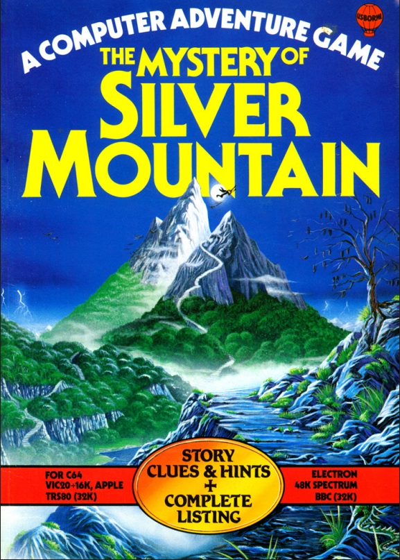
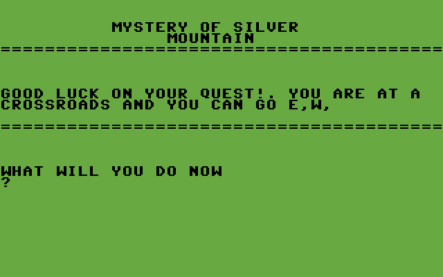
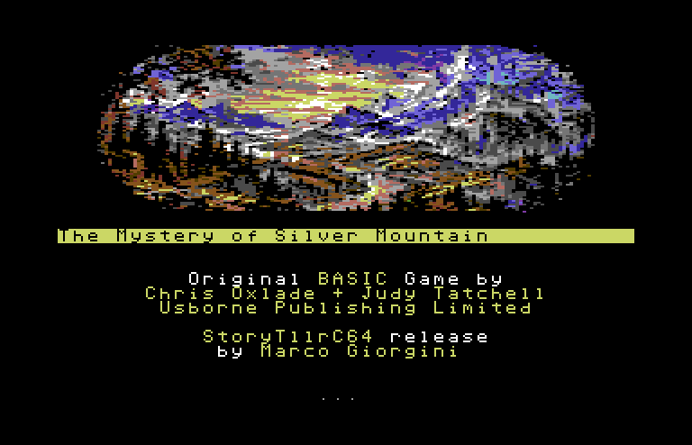
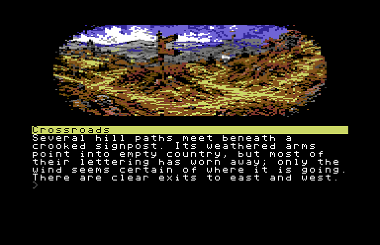
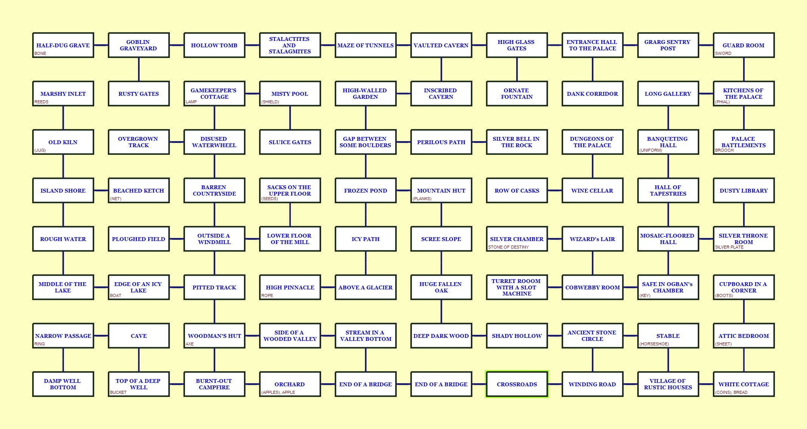
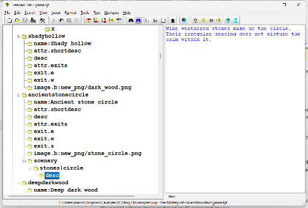
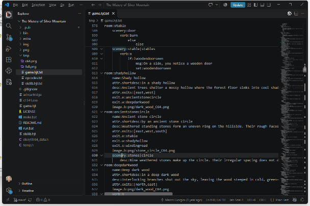

# The Mystery of Silver Mountain

A tribute to **The Mystery of Silver Mountain**, the 1984 BASIC text adventure by **Chris Oxlade and Judy Tatchell**, published by **Usborne**.

The original game came as a source-code listing in a beautifully illustrated book, and it helped inspire my lifelong love of text adventures. It offered a remarkably large and ambitious world, designed to run on several different 8-bit computers. That portability came with very brief descriptions and a simple command system, while some essential clues appeared only in the accompanying book.

This remake uses **StoryTllr64** to bring the adventure to the Commodore 64 with expanded descriptions, additional clues and new graphics. My aim is to preserve the original game's character while making its world more accessible—and to share the scripts so others can explore, adapt and build upon this version.

## About this project

The complete project is freely available here on GitHub as a tribute to the original game and book.

If you enjoy this adaptation, please remember the work of **Chris Oxlade, Judy Tatchell and Usborne**.

This is a derivative fan project. Making it available here does not grant rights to the original material; those rights remain with their respective owners.

## The book

[Read the original English book on the Internet Archive](https://dn790001.ca.archive.org/0/items/the-mystery-of-silver-mountain/the-mystery-of-silver-mountain.pdf)

## The original C64 game

## The remake

## Why remake it?

I was probably thirteen or fourteen when my parents gave me a copy of **The Mystery of Silver Mountain**. It was summer, and my younger brother and I spent hot afternoons typing its BASIC listing into a C64 connected to a green phosphor monitor, before heading out to play in the woods.

It became one of the first text adventures I fell in love with. The book's beautiful illustrations and rich backstory brought its world to life, even though the program itself conveyed that world through just a few words and no graphics.

I thought about it often while making **Nesterin Trail**. After revisiting the original material, I decided to try adapting it with StoryTllr64.

I wanted to do more than reproduce the original with pictures. This version adds descriptions and responses where memory constraints once left little room for them, while preserving the underlying adventure and most of its puzzles.

One important goal was compatibility with the original solution: it should still be possible to complete this version by following [this walkthrough](https://solutionarchive.com/file/id%2C7197/).

That also means preserving some unforgiving features—including sudden deaths and mistakes that can make the game impossible to finish.

## Before you play

This version is more forgiving than the original, but it is still **a difficult, old-school adventure**.

You can die, waste essential supplies, or make a mistake whose consequences only become apparent much later. Some of those mistakes can leave you unable to complete the game.

Expect to explore, take notes, draw a map, save your progress and learn from unsuccessful attempts. Finishing on your first attempt without a guide is unlikely: discovering how to succeed is part of the adventure.

I've added clues, simplified several interactions and prevented some sudden deaths. I have not tried to remove the original game's challenge or turn it into an adventure where every decision is reversible.

A few distinctions inherited from the original are particularly unforgiving. Giving **an apple** is not necessarily the same as giving **all your apples**, and paying with **a coin** can differ from handing over **your coins**. Choose your words carefully!

## Project scope and development status

I began this project unsure whether I could convert the entire adventure. After more than a year of work, the game is complete and ready for an initial release, with **61 location and presentation images across two disks**.

The StoryTllr64 compiler and C64 player now support the two-disk arrangement. Some images are duplicated to reduce disk swapping, particularly when revisiting earlier areas.

The game has undergone manual and AI-assisted playtesting, and the winning ending has been reached. I have also checked that the original walkthrough sequence works in this adaptation.

You will find the released `.d64` files on the [official itch.io page](https://marcogiorgini.itch.io/the-mystery-of-silver-mountain) of the game.

In case you case, there's also an **Italian version** of the game: source codes [game_it.hjt](game_it.hjt)+[stdlib_it.hjt](stdlib_it.hjt) / .d64 files on the [official itch.io page](https://marcogiorgini.itch.io/il-mistero-della-montagna-dargento) of the game.

## Changes from the original

The main changes are expanded text, graphics and additional clues. Several puzzles also require less manual bookkeeping:

- **Maze of Tunnels:** you still need to discover the route information. Once found, the game handles following it without requiring you to enter the complete sequence.
- **Silver Bell in the Rock:** you must obtain the clue first. After that, ringing the bell automatically uses the correct number of rings.
- **Frozen Pond:** the immediate-death situation has been made more forgiving, giving you an opportunity to deal with the dangerous ice.
- **Banquet Hall:** once the sleeping Grarg is present, examining him reveals the uniform.
- **Dusty Library:** the original puzzle required decoding information using an illustration in the companion book. Examining the books now provides the information needed to finish the game.
- **Safe in Ogban's Chambers:** you must discover the combination, but do not need to write it down and enter it manually. The game remembers it.

## Map

One of my first tasks was to create a complete map—not only to reproduce the locations in StoryTllr64, but to understand their connections while working through the original BASIC code.

I converted the location information from the original `DATA` statements into a [Trizbort file](_pub/TheMysteryOfSilverMountain.trizbort), then rendered it as an image.

**Spoiler warning:** the map includes object locations and may reveal discoveries you would prefer to make yourself.

Objects shown in parentheses are hidden at the start. The map records the initial object placements; it does not capture every object movement or discovery triggered by the game logic.

## Source code and acknowledgements

Game source code is in **game.hjt** and **stdlib.hjt** - these files are **TreePad Lite** files (so you can easily open them with that wonderful tool). If you don't have it, or don't want to use it, in **tmp** folder you'll find their text-only tabbed version - same content but a lot easier to read with a text editor.

 

The [StoryTllr64](https://github.com/MGProduction/StoryTllrC64) scripts and supporting material for this adaptation are available in this repository.

Special thanks to the authors of these projects:

- [go-mountain](https://github.com/fivegreenapples/go-mountain): a working Go conversion that greatly helped me understand and work through the original code.
- [SilverMountain](https://github.com/Philbywhizz/SilverMountain): an Inform 7 conversion covering the game's structure, without the gameplay implementation.

## Graphics

The in-game graphics use a mixture of my own and friends' photographs and drawings, assembled stock imagery, and AI-generated images. In the current release, most are based on AI-generated images.

The selected artwork then underwent substantial conversion work and visual adjustment for the C64's resolution, palette and graphics restrictions.

## AI-assisted testing

I wrote the game conversion and its scripts myself. AI was used to assist with playtesting and reviewing descriptions and clues.

To make direct testing possible, I created a **Linux console version of the StoryTllr player**. This allowed an AI assistant to play the compiled adventure through commands and responses, explore puzzle sequences, reproduce problems and check whether fixes worked.

For an adventure this large—with sudden deaths, limited resources and mistakes that may only matter much later—that proved useful. It helped identify implementation errors and missing clues, alongside my own testing and checks against the original material.
